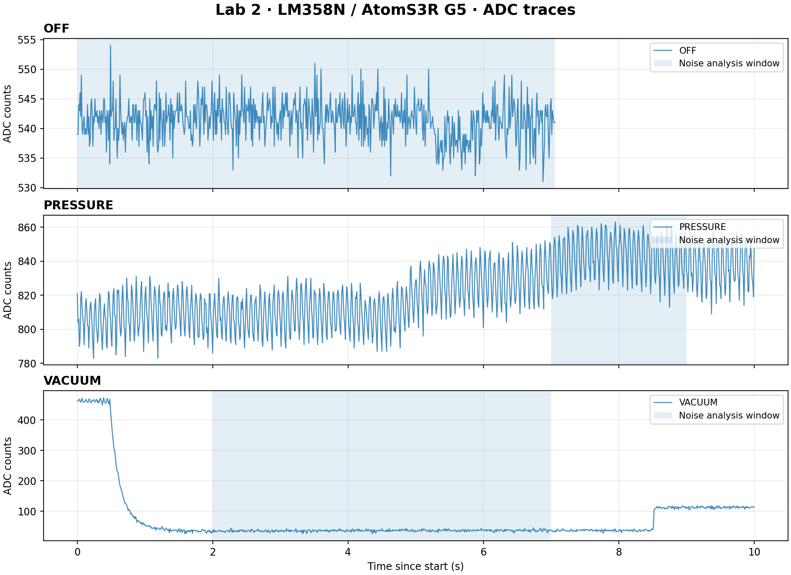

# Labor 2 — ADC mõõtmiste analüüs (uus takistite konfiguratsioon)

## Lähtefailid ja mõõtmisandmete päritolu

Analüüsis kasutatakse **kolme uut ADC toormõõtmiste salvestust**, mis asuvad kaustas `data-acquisition/lab2/data/`:

| Mõõtmisrežiim | Lähtefail (CSV) | Mõõtepunktide arv | Failist arvutatud näitajad |
|---|---|---:|---|
| OFF | [`opamp_test_off_ver2.csv`](../data/opamp_test_off_ver2.csv) | 707 | Veeru `adc` keskmine, miinimum, maksimum ja standardhälve; salvestuse kestus veeru `t_ms` põhjal; `missed` ja `adc_clipped` lipud |
| PRESSURE | [`opamp_test_pressure_ver3.csv`](../data/opamp_test_pressure_ver3.csv) | 1001 | Samad näitajad; lisaks lokaalsed statistilised näitajad ajavahemikus 7–9 s |
| VACUUM | [`opamp_test_vacum_ver3.csv`](../data/opamp_test_vacum_ver3.csv) | 1001 | Samad näitajad; lisaks lokaalsed statistilised näitajad ajavahemikus 2–7 s |

Kõik esitatud ADC statistilised näitajad on arvutatud vastava CSV-faili **veeru `adc`** põhjal. Ajavahemikud on arvestatud iga salvestuse esimese `t_ms` väärtuse suhtes. Standardhälbe arvutamisel kasutatakse valimi standardhälvet (`ddof=1`). Lippe `missed` ja `adc_clipped` kontrollitakse vastavates lähtefailides.

Režiimide OFF, PRESSURE ja VACUUM nimetused põhinevad **failinimedel**, mitte CSV-faili veeru `condition` väärtustel.

**Eraldi multimeetriga mõõdetud näidud (ei ole arvutatud CSV-failidest):** E35 OFF = 0,486 V; E35 PRESSURE = 0,678 V. Neid näite ei tohi segi ajada CSV-failides korduva metaandmeväljaga `dmm_reference_v` (0,19 V). Selles analüüsis ei väideta, et süstlaga oleks katse läbi viidud.

## ADC mõõtmistulemused

| Režiim | N | Kestus (s) | ADC keskmine (kogu salvestus) | ADC min–max | Standardhälve (kogu salvestus) | Valitud ajavahemik (s) | ADC keskmine (ajavahemik) | Standardhälve (ajavahemik) |
|---|---:|---:|---:|---|---:|---|---:|---:|
| OFF | 707 | 7,06 | 541,41 | 531–554 | 3,29 | 0–7,06 | 541,41 | 3,29 |
| PRESSURE | 1001 | 10,0 | 822,29 | 783–863 | 18,6 | 7–9 | 842,6 | 12,51 |
| VACUUM | 1001 | 10,0 | 75,17 | 26–473 | 97,31 | 2–7 | 36,77 | 2,94 |

## Tulemuste tõlgendus

- **OFF:** ADC näit on suhteliselt stabiilne. Standardhälve on ligikaudu 3,29 ADC ühikut.
- **PRESSURE:** ADC näit suureneb salvestuse jooksul. Kogu salvestuse standardhälve sisaldab ka signaali triivi, mitte ainult elektrilist müra. Ajavahemikku 7–9 s kasutatakse lokaalse müra ligikaudseks hindamiseks.
- **VACUUM:** salvestuse alguses langeb ADC näit järsult, ajavahemikus 2–7 s on näit suhteliselt stabiilne ning salvestuse lõpus tõuseb uuesti. Kogu salvestuse suur standardhälve tuleneb peamiselt üleminekutest.
- Nendes failides ei ole registreeritud vahelejäänud mõõtepunkte ega ADC piirväärtuseni jõudmise lippe. Mõõtmiste intervall on 10 ms (ligikaudu 100 Hz).
- Rõhku kPa-des ei saa nende andmete põhjal usaldusväärselt arvutada: veerg `p_kpa` on tühi ning valideeritud rõhukalibreering puudub.
- Kõigi kolme salvestuse veerus `condition` on väärtus `test_signal`; selles analüüsis määratakse režiimid failinimede järgi. Välja `dmm_reference_v` väärtus on failides 0,19 V, mis erineb eraldi E35 punktis mõõdetud väärtustest (OFF 0,486 V; PRESSURE 0,678 V). Seda metaandmevälja ei tohi käsitleda kehtiva kalibreerimisalusena.
- Valitud stabiilsed ajavahemikud on analüüsi käigus määratud; sõltumatult ei ole kinnitatud, et pump töötas neil hetkedel püsirežiimis.

