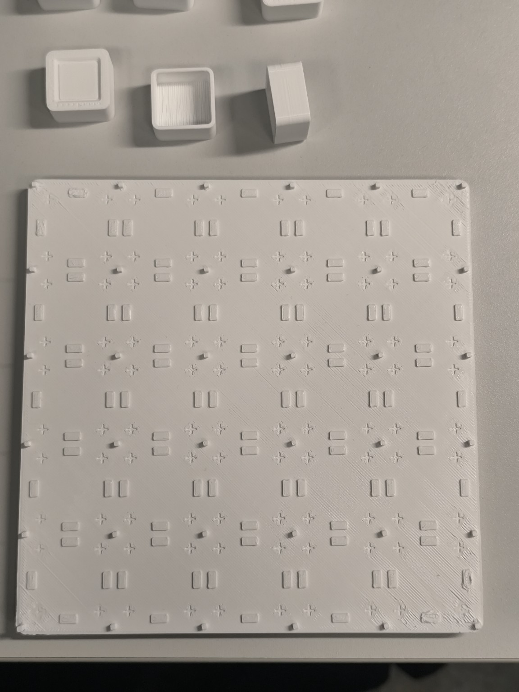
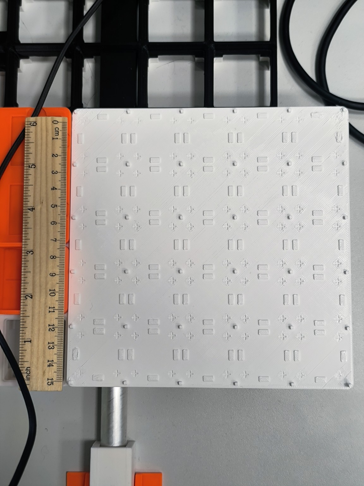
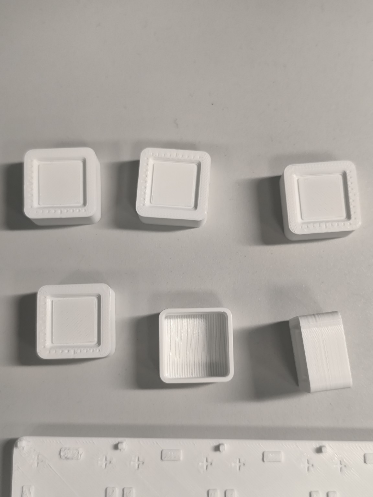
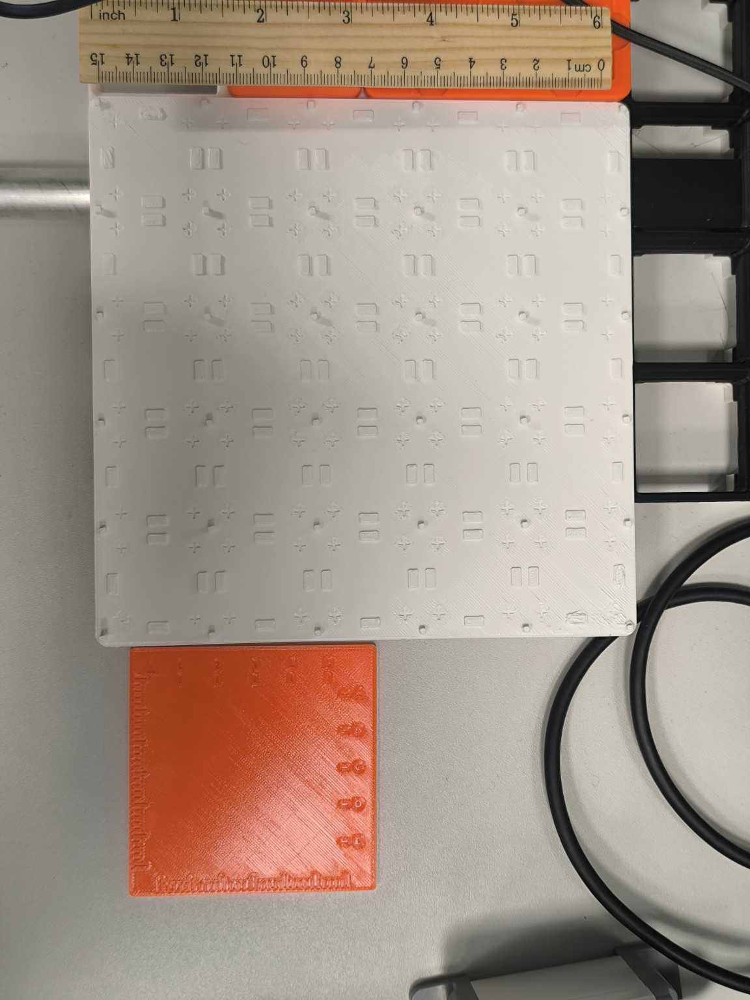
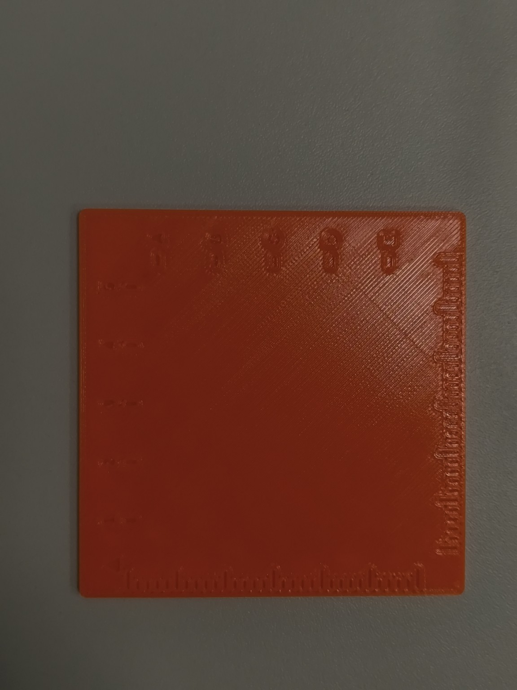

# Tilgaplaadi ja AtomS3R maketi füüsilised mõõtmised — 14.11.2026

Allikas: kasutaja 14.11.2026 edastatud mõõdud ja fotod. Projektmõõdud pärinevad olemasolevast Fusioni mudelist ning `lab3/README.md`-st. Need kaks andmeliiki on allpool eristatud. Mõõtevahendi täpsus ega kordusmõõtmiste hajuvus ei ole kinnitatud. `≈` tähistab ligikaudset väärtust.

## Valge tilgaplaat V2 — esimene prinditud eksemplar

| Väli | CAD/slaiser | Füüsiline mõõtmine/vaatlus |
|---|---:|---:|
| Laius X | 167,5 mm | 167,5 mm |
| Pikkus Y | 167,5 mm | 167,5 mm |
| Kogukõrgus koos Gridfinity jalgadega | Pole siin eraldi määratud | ≈9 mm |
| Klaasitoe kõrgus #1 tööpinna kohal | 0,6 mm | 0,6 mm |
| Klaasitoe kõrgus #2 tööpinna kohal | 0,6 mm | 0,6 mm |
| Klaasitoe kõrgus #3 tööpinna kohal | 0,6 mm | 0,6 mm |
| Gridfinity sobivus | 4 × 4 moodulit | Paigutus stabiilne |

CAD-is on 5 × 5 tilgakohta (samm 32,5 mm), nelja toega klaasipositsioonid ning mõõtemärgised. Need ei ole kõik eraldi füüsiliselt kontrollitud. Kõrgus ≈9 mm on ligikaudne; mõõdetud tugede kõrgused on esitatud ilma täiendava täpsuse väiteta.

Fotod:

## Valge AtomS3R ekraanipoole makett — üks mõõdetud eksemplar

| Väli | CAD | Mõõdetud |
|---|---:|---:|
| Korpuse X | 24,0 mm | 24,0 mm |
| Korpuse Y | 24,0 mm | 24,0 mm |
| Korpuse Z | 12,8 mm | **12,9 mm** |
| Ekraani sügavus raamist | 1,2 mm | ≈1,2 mm |
| Sobivus | — | Stabiilne |

Z erinevus CAD-ist on **+0,1 mm**. Kasutaja parandas esialgse 12,8 mm väärtuse 12,9 mm-ks. Denysi CAD-mudel sisaldab ekraanisüvendi lisageomeetriat. Nende detailide füüsilisi mõõte eraldi ei kontrollitud. CAD-parameetrid on [labori README-s](../README.md#nõutavad-väljundid).

## Oranž tilgaplaat V1 — esialgne füüsiline prototüüp

| Väli | Füüsiline mõõtmine/vaatlus |
|---|---|
| Laius X | 80 mm |
| Pikkus Y | 80 mm |
| Paksus Z | 2,4 mm |
| Materjal | Oranž PLA |
| Klaasi toed/positsioneerijad | Puuduvad |
| Gridfinity liides | Puudub; ei sobi tööalasse |

[V1 kaustas](v1/README.md) on kasutaja arhiivist pärit algfailid ja nende digitaalse kontrolli kirjeldus. Ülal on kasutaja füüsilised mõõdud.

## Teine valge tilgaplaat V2

- G-code: [`bgcode/tilgaplaat-2_0.4n_0.2mm_PLA_COREONE_2h38m.bgcode`](bgcode/tilgaplaat-2_0.4n_0.2mm_PLA_COREONE_2h38m.bgcode).
- **Seis 14.11.2026:** prinditud ja valmis (kasutaja teade).
- Slaiseri prognoos: 2 h 38 min ja 97 g; need ei ole mõõdetud tegelikud tulemused.

| Väli | CAD/slaiser | Füüsiline mõõtmine/vaatlus |
|---|---:|---:|
| Laius X | 167,5 mm | 167,5 mm |
| Pikkus Y | 167,5 mm | 167,5 mm |
| Klaasitoe kõrgus tööpinna kohal | 0,6 mm | 0,6 mm |
| Gridfinity sobivus | 4 × 4 moodulit | Paigutus stabiilne |
| Klaasi asend nurgatihvtide vahel | 30,6 mm (30 mm klaas + 0,3 mm lõtk külje kohta) | Klaas liigub tihvtide vahel vabalt (kasutaja vaatlus); tihvtide vahe ja klaasi mõõt TODO |
| Foto | — | TODO |

## Katsed, mida ei ole kinnitatud

Vaigu doseerimine, 405 nm UV kõvendamine, kaamera skaala mm/px, rõhukõverate mõõtmine, tilga suurus, klaasi asetamine, robotikatsed ning teise V2 X/Y-mõõdud ja foto: **TODO**. Lähtemudel: [`src/da-lab3-tilgaplaat-atoms3-mudel.f3d`](src/da-lab3-tilgaplaat-atoms3-mudel.f3d) (V2).
