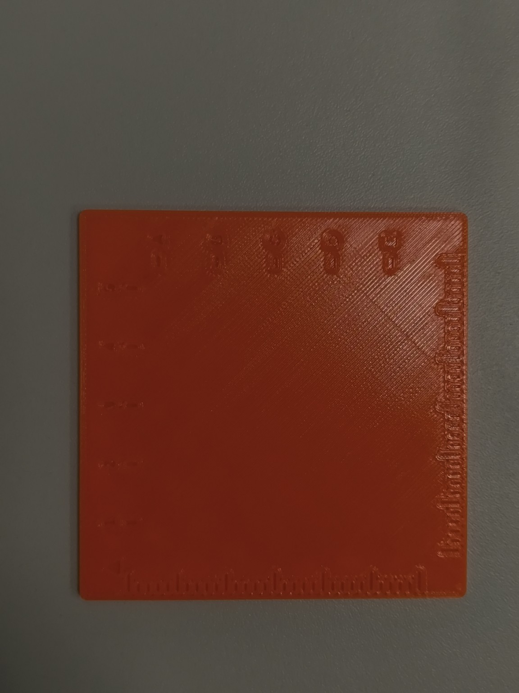
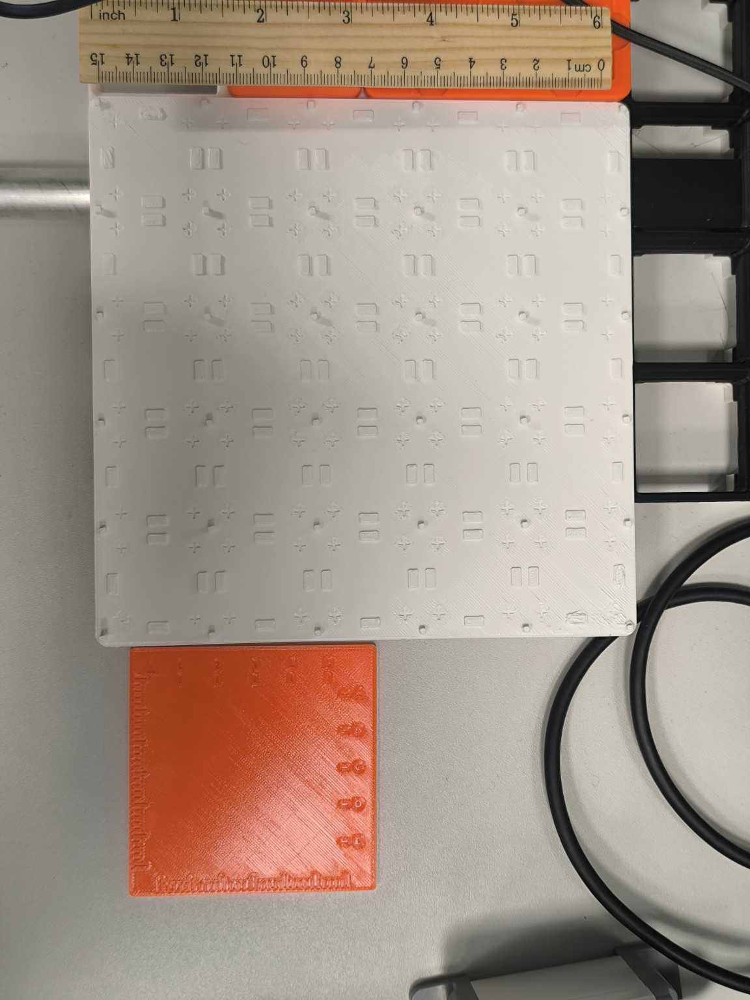

# Oranž tilgaplaat V1 — esimene prototüüp

**Olek:** prinditud varasem prototüüp. Säilitatakse arendusversioonina, mitte ei esitata praeguse V2 funktsionaalse tilgaplaadina.

## Mõõdetud 14.11.2026

| Parameeter | Väärtus |
|---|---|
| X | 80 mm |
| Y | 80 mm |
| Z (paksus) | 2,4 mm |
| Materjal | Oranž PLA |
| Klaasitoed | Puuduvad |
| Gridfinity | Ei sobi; liides puudub |

V1 on V2-st märgatavalt väiksem ning puuduvad klaasi positsioneerivad detailid ja Gridfinity liides. Valge V2 (167,5 × 167,5 mm) lisab need funktsioonid.

## Fotod

## V1 algfailid

Kasutaja andis failid arhiivis `tilgaplaat_v1.zip`. Failinimed ja sisu on algsel kujul.

- [Fusion 360](tilgaplaat_Lab3_v1.f3d): Fusioni dokumendi andmed, BRep-failid ja eelvaade. Eelvaate servamärgised, tasane pind ja ümardatud nurgad vastavad V1 fotol nähtule. Fusionis mudelit ei avatud.
- [OpenSCAD](tilgaplaat_Lab3_v1.scad): plaadi külje parameeter on 80 mm ja paksus 2,4 mm. Märgised on süvistatud.
- [STEP](tilgaplaat_Lab3_v1.step): Open CASCADE'i eksport millimeetrites. 3D-tippude ulatus on 80 × 80 × 2,4 mm.
- [STL](tilgaplaat_Lab3_v1.stl) ja [3MF](tilgaplaat_Lab3_v1.3mf): mõlema võrgu gabariit on 80 × 80 × 2,4 mm ja kummaski on 6250 kolmnurka. 3MF on PrusaSliceri projekt, mis viitab sisemiselt nimele `tilgaplaat_final.stl`.

Need kontrollid seovad arhiivi failid V1 kujundusega. V1 G-code'i arhiivis ei ole ja konkreetse prindieksemplari käivitusfail on tuvastamata.

V2 Fusioni mudel asub [`../src/da-lab3-tilgaplaat-atoms3-mudel.f3d`](../src/da-lab3-tilgaplaat-atoms3-mudel.f3d) ega ole V1 originaal.
