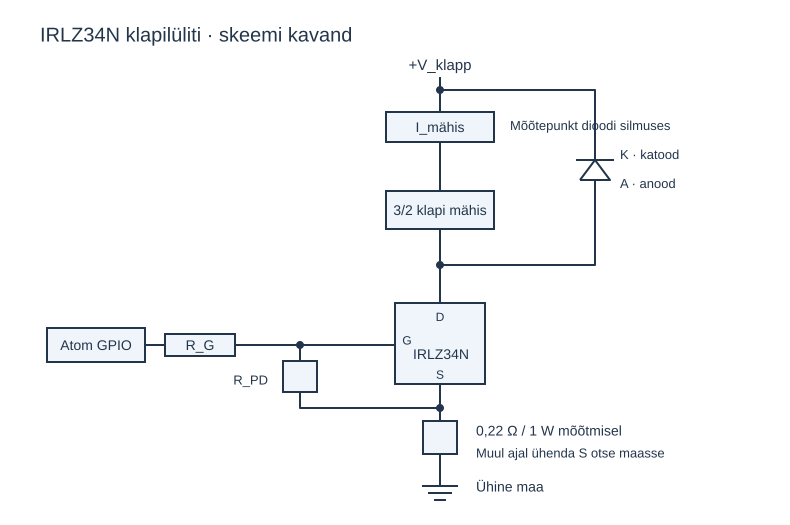

# IRLZ34N klapilüliti ja mõõteplaan

## Skeemi kavand

IRLZ34N lülitab 3/2 klapi alalisvoolumähist madalpoolelt. Kontrolli enne koostamist klapi ja dioodi markeeringut, nimipingeid, toite tegelikku vahemikku ja Atomi vaba väljundviiku. CAD Lab 3 mõõtis ühe klapi klemmidel 589,6 Ω ja luges märgistust DC 24 V, 1 W. Samal klapil oli diooditaoline osa. Kinnita selle ühendus ja polaarsus ning kontrolli, kas mõõdetud koost jõuab Andmehõive katsesse. [CAD mõõteprotokoll](https://github.com/Dennel04/3d-printing-course/blob/main/3d-print/lab3/docs/measurements.md#m%C3%B5%C3%B5tmised-15112026)

[Muudetav draw.io skeem](mosfet-circuit.drawio)

- Ühenda pais Atomi väljundiga läbi jadatakisti `R_G`. Takisti piirab paisu laadimisvoolu ja mõjutab servade kiirust. `R_PD` paisult MOSFET-i lähtele hoiab lüliti Atomi käivitumisel ja toite kadumisel suletuna. Märgi lõpliku skeemi juurde mõlema takisti valitud väärtus Ω ja valiku alus. Viik ning väärtused ootavad andmelehe- ja stendikontrolli.
- Kaitsedioodi katood läheb mähise toite poolele ja anood neelu poolele. Vali diood mähise voolu, korduva PWM-i, lülituskiiruse, pöördpinge ja siirete järgi. Ahelal on ühine maa. Klapi toide ei tohi jõuda Atomi viigule.
- Mõõda tegelik `V_GS`, sisselülitatud MOSFET-i `V_DS` ja korpuse temperatuur koormuse all. Paisu lävipingest üksi ei piisa 3,3 V juhtimise sobivuse kinnituseks. Kui avanemine, kaod või temperatuur kujunevad lubamatuks, peata katse ja vaata juhtaste juhendajaga üle. [IRLZ34N andmeleht ja tootja andmed](https://www.infineon.com/part/IRLZ34N)
- Säilita lõplik skeem pildi ja muudetava lähtefailina. Lisa ahelafoto ja kuupäev, sama skeemiversioon olgu katselogis. Laboris kasutatakse maketeerimisplaati ja jootmist ei tehta.

## Relee ja MOSFET-i võrdlus

Kasuta võimalusel sama klappi, voolikujaotust, toidet, anduripaika ja mõõteviidet. Kui mõni tingimus erineb, märgi see võrdlustabelis. [Lab 3 relee tööleht](../../lab3/docs/bench_session.md#klapp-ja-relee)

| Mõõdetav näit | Meetod ja ühik | Lab 3 relee | Lab 4 MOSFET |
| --- | --- | --- | --- |
| Sisse- ja väljalülitus | Kaks ostsilloskoobikanalit, GPIO käsk ja mähise pinge. Raporteeri mõlemad viivitused ja korduste hajuvus ms, kasuta sama dokumenteeritud servakriteeriumi. | Ootel | Ootel |
| Põrge ja servad | Salvesta sisse- ja väljalülituse ostsillogrammid samas mõõtkavas. Märgi põrge või muu siire ja selle kestus ms. | Ootel | Ootel |
| Lühim korratav tilk | Ohutuspiirides impulsside katseseeria fikseeritud rõhu, otsiku ja vaiguga. Märgi lühim korratav impulss ms, pindala mm² ja õnnestunud kordused. Kõrvuta elektriline ja rõhu põhjal hinnatud klapi avanemine. | Ootel | Ootel |
| Mähise vool | Dokumenteeri mõõtepunkt ja vahend. Salvesta käivitus, täisvoolu püsiosa ja MOSFET-i puhul PWM-i hoidevool mA. | Ootel | Ootel |
| Kütmine | MOSFET-il mõõda `V_DS` V ja korpuse temperatuur °C. Võrdle mähise temperatuuri täisvoolul ja PWM-il võrdse kestuse ning ümbritseva temperatuuriga. | Mähise lähtejoon ootel | Ootel |

Ostsilloskoobi maandus ühenda ainult kinnitatud ühisesse referentsi. Mähise diferentsiaalpinge jaoks kasuta sobivat diferentsiaalset mõõtmist, näiteks kontrollitud referentsiga kanalite vahet eraldi katses. Ostsilloskoobi maaühendus ei tohi lühistada jõuahelat.

## Mähise vool ja PWM

1. **Mähise vool.** Pane sobiv multimeeter (õppejõu töölehel 10 A pesa, kontrolli eraldusvõimet) või INA219 järjestikku mähisega dioodi tagasivoolusilmusesse, katoodi ühendussõlme ja mähise ülemise klemmi vahele. Nii läbib andurit ka PWM-i pausis ringlev vool. Kontrolli INA219 mooduli šunti, mõõtepiirkonda, 3,3 V loogikaga sobivust ning sisendite ühisrežiimi pinget koos toite hälbe ja siiretega. Kiibi andmeleht annab ühisrežiimi vahemikuks 0–26 V. Kui konkreetne moodul või mõõterežiim ei sobi, kasuta juhendajaga kinnitatud mõõtevahendit. [TI INA219 andmeleht](https://www.ti.com/lit/ds/symlink/ina219.pdf)
2. **Voolu kuju.** Pärast pingestamata ahela kontrolli saab lähte ja maa vahele lisada 0,22 Ω / 1 W mõõtetakisti. Arvuta ostsillogrammist `I = U / R`. See näitab MOSFET-i haru voolu ning sisselülitatuna mähise voolu. PWM-i väljalülitatud osas liigub mähise vool mööda dioodi. Märgi tõusukõvera võimalik avanemisjälg ja kontrolli seda rõhuandmega. Toitejuhtme vool kirjeldab toite koormust.
3. **Hoidevool.** Ava klapp täisvooluga, seejärel proovi juhendaja kinnitatud PWM-i sagedusi ja täitetegureid. Dokumenteeri sagedus Hz, täitetegur %, avanemisimpulss ms, täis- ja hoidevool mA ning mähise temperatuur °C koos mõõtemeetodiga. Kontrolli, et klapp püsib avatuna ja vabastab väljalülitamisel süstlaharu. Kui hindad temperatuuri mähise takistuse muutusest, mõõda külm võrdlustakistus ja temperatuur ning kasuta sama mähise põhjendatud temperatuuritegurit. Korpuse temperatuur jääb eraldi. Releega PWM-i ei tehta.
